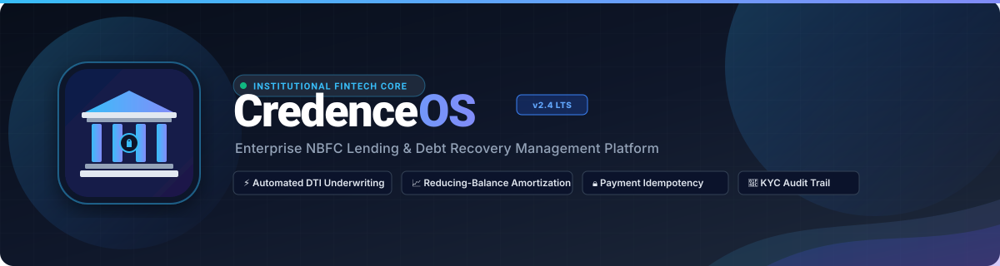
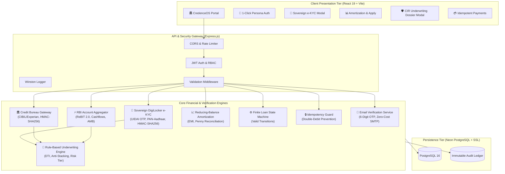

<!-- 🏛️ CREDENCEOS - ENTERPRISE NBFC LENDING MANAGEMENT PLATFORM -->

<p align="center">
  <a href="https://github.com/Aditya16703/CredenceOS-">
    
  </a>
</p>

<p align="center">
  <a href="https://credence-os.vercel.app">
    
  </a>
</p>

<p align="center">
  <a href="https://credence-os.vercel.app"></a>
  <a href="https://credenceos.onrender.com/health"></a>
  <a href="https://github.com/Aditya16703/CredenceOS-/actions/workflows/ci-cd.yml"></a>
</p>

<p align="center">
  
  
  
  
  
  
  
  
  
  
</p>

---

## 🌐 Live Production Deployments

Experience the live institutional lending platform across our production environments:

| Environment | Service | Live Link | Status |
| :--- | :--- | :--- | :--- |
| **Frontend Web App** | React 19 + Vite UI | [**credence-os.vercel.app**](https://credence-os.vercel.app) | 🟢 Live |
| **Backend REST API** | Express.js Core Engine | [**credenceos.onrender.com**](https://credenceos.onrender.com) | 🟢 Live |
| **Database** | Neon Cloud PostgreSQL (SSL) | `ep-red-star-b3l0toch-pooler (AWS ap-southeast-1)` | 🟢 Active |
| **Source Code** | GitHub Repository | [**Aditya16703/CredenceOS-**](https://github.com/Aditya16703/CredenceOS-) | 🟢 Public |

---

## ⚡ 1-Click Evaluator Personas (Live Testing)

Test the complete institutional lending, cashflow underwriting, and debt recovery lifecycle:

| Persona | Role | Credentials | Capabilities |
| :--- | :--- | :--- | :--- |
| 👑 **Executive Admin** | `admin` | `admin@example.com` / `admin123` | Full credit portfolio analytics, global risk policy, and compliance audit trail |
| 🔍 **Senior Loan Officer** | `loan_officer` | `officer@example.com` / `agent123` | KYC inspection queue, RBI Account Aggregator cashflow audits, loan approvals |
| 🛡️ **Recovery Officer** | `agent` | `agent@example.com` / `agent123` | Delinquent borrower worklists, field recovery tracking, and overdue recovery status |
| 🟢 **Prime Borrower** | `customer` | `customer@example.com` / `customer123` | Verified KYC, active loan (₹2,00,000), reducing EMI schedules, UPI payments |
| 🔴 **Overdue Borrower** | `customer` | `rohan.deshmukh@example.com` / `customer123` | Subprime profile, overdue delinquency, field visit scheduled |

> 💡 *Tip: On the [Live Portal](https://credence-os.vercel.app), click any of the **"⚡ 1-Click Evaluator Login"** buttons to auto-authenticate instantly.*

---

## 🎯 Executive Overview

**CredenceOS** is an institutional-grade Lending Management Platform built for Non-Banking Financial Companies (NBFCs), digital neo-banks, and credit originators. 

Unlike naive CRUD loan demos, CredenceOS incorporates core financial engineering primitives:
1. **Deterministic State Machine**: Strictly enforces regulatory state lifecycles (`DRAFT` → `SUBMITTED` → `UNDER_REVIEW` → `APPROVED` → `DISBURSED` → `ACTIVE` → `CLOSED` / `OVERDUE`).
2. **Sovereign DigiLocker & UIDAI e-KYC Gateway**: Simulates sovereign identity verification, enforces PAN-Aadhaar biometric linkage, applies PMLA Rule 9 canonical legal name overwrite, and seals identity with HMAC-SHA256 checksums.
3. **Authenticated Credit Bureau Gateway**: Pulls KYC-bound Credit Information Reports (CIBIL/Experian), validates 10-char PAN tax format, issues 12-digit Control Numbers, and signs reports with HMAC-SHA256 signatures to prevent client score spoofing.
4. **Explainable Underwriting & Anti-Loan-Stacking Engine**: Multi-factor Debt-to-Income (DTI) computation, tradeline reconciliation across internal and external bureaus, and transparent risk factor attribution.
5. **Reducing-Balance Amortization Engine**: Precision monthly repayment calculation with penny/cent-level final installment reconciliation down to exactly `0.00`.
6. **Cryptographic Payment Idempotency**: Atomic database transactions protected by `Idempotency-Key` headers to eliminate double-debit anomalies.
7. **Event-Sourced Audit Ledger**: Append-only compliance log capturing actor, role, IP address, and JSON state deltas.

---

## 🏛️ System Architecture



---

## 🔬 Core Financial Calculations & Logic

### 1. Reducing-Balance Amortization Formula

The platform computes Equated Monthly Installments (EMI) using the true reducing-balance actuarial formula:

$$\text{EMI} = P \times r \times \frac{(1+r)^n}{(1+r)^n - 1}$$

Where:
* $P$ = Principal Loan Amount
* $r$ = Periodic Monthly Interest Rate $\left(\frac{\text{Annual Rate}}{12 \times 100}\right)$
* $n$ = Loan Tenure in Months

> **Reconciliation Guarantee**: The final installment automatically absorbs fractional rounding residues so that:
> $$\text{Closing Principal}_{n} \equiv 0.00$$

### 2. Explainable Underwriting & Anti-Loan-Stacking Engine

The underwriting decision engine evaluates credit eligibility and prevents **loan stacking** before credit facility origination:

$$\text{DTI Ratio} = \frac{\text{Existing Monthly Debts} + \text{Proposed EMI}}{\text{Monthly Income}} \times 100\%$$

| DTI Threshold | Credit Score | Risk Tier | Decision Rule |
| :---: | :---: | :---: | :---: |
| $\le 35\%$ | $\ge 750$ | **LOW RISK** | ✅ Auto-Approved (Prime rate) |
| $36\% - 50\%$ | $650 - 749$ | **MODERATE RISK** | 🔍 Referred for Underwriter Review |
| $> 50\%$ | $< 650$ | **HIGH RISK** | ⚠️ Flagged for Collateral / Guarantor |
| $> 60\%$ | Any | **UNACCEPTABLE** | ❌ Hard Rejection (`REJECT_OR_REFER`) |

#### Multi-Layer Anti-Loan-Stacking Architecture:
To prevent borrowers from taking multiple simultaneous loans across lenders:
1. **Internal Platform Query**: Counts existing `ACTIVE`, `OVERDUE`, and `DISBURSED` facilities on CredenceOS.
2. **External Bureau Tradelines**: Reconciles external active facilities from credit bureaus (CIBIL/Experian):
   $$\text{Total Active Tradelines} = \max(\text{Internal Active Loans},\, \text{Bureau Tradelines})$$
3. **Obligation Floor**: Takes the higher of declared monthly debt and bureau-verified monthly obligations:
   $$\text{Effective Monthly Debt} = \max(\text{Declared Debt},\, \text{Bureau Reported Debt})$$
4. **Leverage Threshold**: If active loans exceed 3 facilities, the engine flags the application as `OVER_LEVERAGED` and applies an automated risk score penalty.
5. **Account Aggregator Cashflow Audit**: Scans bank statements for hidden recurring ECS/NACH loan debits and bounce returns.

### 3. Institutional Credit Bureau (CIC) Gateway & Anti-Spoofing Architecture

To meet regulated banking and NBFC standards, the platform strictly disallows client-submitted credit scores:
* **Zero-Trust Input**: The server discards any client-spoofed `creditScore` in the HTTP body.
* **KYC-Bound Inquiries**: Credit pulls strictly require a `VERIFIED` KYC profile and validate the borrower's Permanent Account Number (PAN) format against the regulatory specification:
  $$\text{Regex Pattern: } \texttt{/^[A-Z]\{5\}[0-9]\{4\}[A-Z]\{1\}\$/}$$
* **Audit Metadata & 12-Digit Control Numbers**: Inquiries return official 12-digit CIC Control Numbers and unique Report IDs (e.g., `CIR-CIBIL-202609018471`).
* **Cryptographic Tamper-Proofing**: Each credit report is hashed using HMAC-SHA256:
  $$\text{Signature} = \text{HMAC-SHA256}(\text{ControlNumber} \parallel \text{PAN} \parallel \text{Score} \parallel \text{InquiryTimestamp})$$
* **Tradeline Reconciliation**: Underwriting reconciles declared monthly debts with bureau-reported monthly obligations and active tradelines.

### 4. ⚡ RBI Account Aggregator (AA) Framework & Cashflow Verification (ReBIT 2.0 Standard)

CredenceOS integrates the official **Reserve Bank of India (RBI) / ReBIT 2.0 Account Aggregator standard** for automated bank cashflow underwriting:
* **FIP Bank Registry**: Connects with major institutional Financial Information Providers (**HDFC, State Bank of India, ICICI, Axis, Kotak, PNB**).
* **Digital Consent Lifecycle**: Enforces borrower consent management (`initiateConsent` returning ReBIT `consentHandle` $\rightarrow$ OTP approval $\rightarrow$ active `consentId`).
* **6-Month Automated Bank Cashflow Analysis**:
  * **Verified Salary Credits**: Scans transaction history, extracts corporate salary credits and employer name (e.g., *Tata Consultancy Services, Infosys*), eliminating PDF salary slip fraud.
  * **Average Monthly Balance (AMB)**: Computes true account liquidity buffer.
  * **Bounced Transaction Detection**: Identifies ECS / NACH return debits (critical early warning of borrower distress).
  * **HMAC-SHA256 Digital Signature**: Generates an append-only digital signature (`tamperProofAuditHash`) ensuring financial statement integrity.
* **Underwriting Discrepancy Penalty**: The underwriting engine cross-checks user-declared income against bank-verified salary. If declared income exceeds banking credits by $> 20\%$, the system flags an `AA_INCOME_MISMATCH` and triggers a 30-point risk penalty.

### 5. 🔐 Zero-Cost Transactional Email Verification (6-Digit OTP Flow)

To ensure verified account ownership without requiring expensive third-party SMS/email subscriptions:
* **Zero-Cost Architecture**: Built on `nodemailer` to support free standard SMTP (such as a **free Gmail App Password**, Brevo free tier, or custom SMTP) with automatic [Ethereal Email](https://ethereal.email) test inboxes and terminal fallback logging for zero-friction development.
* **Cryptographic 6-Digit OTP**: Generates random 6-digit codes (`crypto.randomInt(100000, 999999)`) with a strict 10-minute time-to-live.
* **2-Step Onboarding Experience**: Borrowers register identity details and are transitioned to an interactive verification card with a 60-second "Resend Code" countdown timer and auto-login upon confirmation.

### 6. 🪪 Sovereign DigiLocker & UIDAI e-KYC Gateway (PMLA Rule 9 & Section 139AA)

CredenceOS implements an institutional, bank-grade e-KYC architecture compliant with statutory identity verification standards:
* **UIDAI / DigiLocker Sovereign OTP Challenge**: 2-stage verification protocol (`initiateEKYCChallenge` and `verifyEKYCOTP`) with session state caching, masked mobile dispatch (`+91 ******4829`), and last-4-digit Aadhaar tokenization (`XXXX-XXXX-XXXX`).
* **CBDT / NSDL Protean Biometric Linkage**: Validates Income Tax PAN against national registries under Section 139AA; hard-blocks unlinked or `INOPERATIVE` PAN credentials from credit origination.
* **PMLA Rule 9 Canonical Source-of-Truth Overwrite**: Strictly avoids fuzzy name guesswork. The official government registry name is the immutable source of truth; borrower account profiles are authoritatively overwritten and bound to their verified legal entity name.
* **Statutory Underage Gate**: Enforces a strict age floor ($\ge 18$ years) derived deterministically from the statutory date of birth.
* **HMAC-SHA256 Tamper-Proof Audit Sealing**: Every verified dossier generates an immutable cryptographic signature:
  $$\text{Seal} = \text{HMAC-SHA256}(\text{PAN} \parallel \text{AadhaarLast4} \parallel \text{CanonicalName} \parallel \text{DOB} \parallel \text{UIDAIRef} \parallel \text{VerifiedAt})$$
* **Anti-Theft Bank Disbursement Legal Ownership Matching**: In accordance with the **RBI 2022 Digital Lending Mandate**, loan disbursements verify that the destination bank Core Banking Solution (CBS) account holder matches the borrower's sovereign canonical legal entity.

---

## 💻 Tech Stack & Infrastructure

```
CredenceOS
├── 🎨 Frontend          React 19, Vite, Plus Jakarta Sans, Lucide Icons, Glassmorphism
├── ⚙️ Backend           Node.js 20+, Express.js, Sequelize ORM, Winston, Crypto HMAC, Nodemailer
├── 🗄️ Database          PostgreSQL 16 (Neon Serverless with SSL)
├── 🐳 Containers        Docker, Docker Compose, Multi-stage Nginx Build
├── 🚀 CI/CD Pipeline    GitHub Actions (Automated Unit Tests & Vite Build)
└── ☁️ Hosting           Render (API Service) + Vercel (Production UI)
```

---

## 🛠️ Local Development & Quickstart

### Prerequisites
* **Node.js**: v18.0.0 or higher
* **PostgreSQL**: Local installation or cloud connection string
* **Docker & Docker Compose** (Optional for containerized run)

### Method 1: Bare Metal Development

```bash
# 1. Clone repository
git clone https://github.com/Aditya16703/CredenceOS-.git
cd CredenceOS-

# 2. Configure Backend Environment
cd backend
npm install
cp .env.example .env   # Configure DATABASE_URL and JWT_SECRET
npm run dev

# 3. Configure Frontend Environment (in a new terminal)
cd ../frontend
npm install
npm run dev
```

* Frontend running at: `http://localhost:5173`
* Backend API running at: `http://localhost:5000`

### Method 2: Multi-Container Docker Compose

```bash
# Build and run backend + frontend + postgres containers
docker-compose up --build
```

---

## 🧪 Automated Test Suite

CredenceOS includes comprehensive unit tests verifying the mathematical integrity of the financial calculation engines, bureau anti-tampering, state transitions, RBI Account Aggregator flow, and email OTP verification:

```bash
cd backend
npm test
```

```text
TAP version 13
ok 1 - Amortization Engine - calculateEMI returns accurate financial numbers
ok 2 - Amortization Engine - 0% interest edge case
ok 3 - Amortization Engine - Final installment reconciles closing principal to exactly 0.00
ok 4 - Underwriting Engine - Low risk profile approved with healthy DTI
ok 5 - Underwriting Engine - High risk profile flagged when DTI is extreme
ok 6 - Loan State Machine - Valid and invalid transitions
ok 7 - KYC Compliance - PAN masking protects sensitive identity
ok 8 - Payment Idempotency - Key caching simulation
ok 9 - Credit Bureau Gateway - Validates score range (300 to 900)
ok 10 - Credit Bureau Gateway - Successfully pulls authenticated report for valid KYC PAN
ok 11 - Credit Bureau Gateway - Rejects malformed PAN format
ok 12 - Credit Bureau Gateway - Blocks credit inquiry without explicit consumer consent
ok 13 - Credit Bureau Gateway - Detects tampering in bureau report record
ok 14 - Credit Bureau Gateway - High risk subprime profile correctly flows into Underwriting
ok 15 - Email Verification - Generates and dispatches 6-digit OTP code
ok 16 - Account Aggregator - Registry lists valid RBI-registered FIP banks
ok 17 - Account Aggregator - Initiates ReBIT consent and returns valid consent handle
ok 18 - Account Aggregator - Verifies OTP and retrieves authenticated cashflows
ok 19 - Sovereign e-KYC - Initiates DigiLocker challenge session and returns masked phone
ok 20 - Sovereign e-KYC - Verifies OTP, executes canonical overwrite, and generates HMAC seal
ok 21 - Sovereign e-KYC - Rejects unlinked PAN-Aadhaar records
ok 22 - Sovereign e-KYC - Rejects underage applicant (under 18)
ok 23 - Sovereign e-KYC - Bank disbursement ownership validation (Anti-Theft)
1..23
# tests 23 | pass 23 | fail 0
```

---

## 📁 Repository Structure

```
CredenceOS-
├── .github/workflows/         # Automated GitHub Actions CI/CD pipeline
├── backend/
│   ├── src/
│   │   ├── controllers/      # auth, loan, payment, kyc, audit, accountAggregator, report
│   │   ├── models/           # Sequelize ORM schema definitions & UnderwritingRecord
│   │   ├── routes/           # RESTful API route definitions (auth, loan, kyc, audit, accountAggregator, report)
│   │   ├── services/         # Amortization, underwriting, creditBureauService, accountAggregatorService, kycVerificationService, mailService
│   │   └── server.js         # Express server entry point & error handlers
│   └── tests/                # Mathematical calculation, bureau security, AA, OTP & Sovereign e-KYC tests
├── frontend/
│   ├── src/
│   │   ├── components/       # UnderwritingModal, Account Aggregator consent modal, Notifications
│   │   ├── pages/            # Home, Dashboard, Loans (with AA widget), Payments, KYC, Register (OTP flow)
│   │   ├── utils/            # api.js client, session management, token handlers
│   │   ├── index.css         # Institutional design system tokens & glassmorphism
│   │   └── App.jsx           # Authenticated root router
│   └── vercel.json           # Single-page application routing rules
├── docker-compose.yml         # Full-stack multi-container specification
├── render.yaml                # Render Blueprint infrastructure deployment
└── README.md                  # Institutional documentation
```

---

## 📜 Compliance & Security Architecture

* **PII Redaction**: Identity documents (Permanent Account Number - PAN, Aadhaar) are stored in compliant masked representations (`XXXXXX1234`).
* **Stateless Security**: Authentication is managed via salted bcrypt hashes (10 rounds) and signed JSON Web Tokens (JWT).
* **Double-Debit Mitigation**: Payment endpoints require a cryptographic `Idempotency-Key` preventing concurrent submission race conditions.
* **Audit Trail Immutability**: All credit decisions and status movements append to a non-destructive audit log.

---

## 👨‍💻 Author & Contact

**Aditya Singh Chauhan**  
*Full Stack Financial Software Engineer*

[](https://github.com/Aditya16703)
[](https://linkedin.com)
[](mailto:ac3413452@gmail.com)

---

## 📄 License

This project is licensed under the **MIT License** — see the [LICENSE](LICENSE) file for complete details.

<p align="center">
  
</p>
